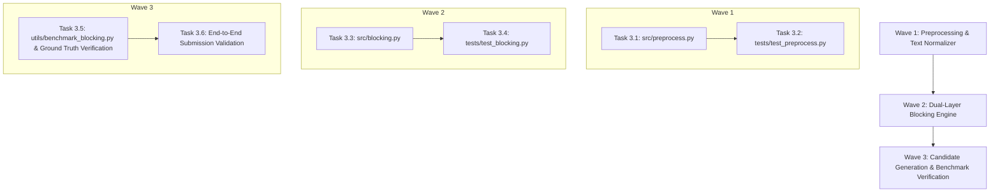

# Phase 3 Plan: Out-of-Core Blocking & Candidate Generation

**Phase Target**: Phase 3  
**Status**: Ready for Execution  
**Context File**: [.planning/03-CONTEXT.md](file:///c:/Users/AYUSH/Documents/MLChallenge/.planning/03-CONTEXT.md)  
**Parent Roadmap**: [.planning/ROADMAP.md](file:///c:/Users/AYUSH/Documents/MLChallenge/.planning/ROADMAP.md)

---

## 1. Phase Objective & Success Criteria

The goal of Phase 3 is to construct an out-of-core, high-recall blocking engine that ingests multi-source business data (Source 1 reference, Source 2 & Source 3 noisy sources) and generates `output/candidate_pairs.tsv`.

### Success Criteria:
1. **Candidate Pool Budget**: Bounded strictly to $\le 30$ candidate entities per Source 1 entity.
2. **Recall Ceiling**: $\ge 98\%$ recall on training ground truth (`dataset/train/train_ground_truth.tsv`).
3. **Memory Footprint**: Peak RAM $< 4\text{ GB}$ (tested for out-of-core scalability up to 50–100GB).
4. **Validation Pass**: Zero validation warnings or errors when inspected by [utils/validate_submission.py](file:///c:/Users/AYUSH/Documents/MLChallenge/utils/validate_submission.py).
5. **Deterministic Test Pass**: 100% test pass rate across new test suites (`tests/test_preprocess.py` and `tests/test_blocking.py`).

---

## 2. Dependency Graph & Execution Waves

---

## 3. Detailed Task Specifications

### Wave 1: Preprocessing & Text Normalizer

#### Task 3.1: Implement `src/preprocess.py`
- **Target File**: `src/preprocess.py`
- **Key Components**:
  - `normalize_text(text: str) -> str`:
    - NFKD Unicode normalization to decompose diacritics/accents (`é` -> `e`, `ç` -> `c`).
    - Lowercase conversion and punctuation removal (preserving alphanumerics and single spaces).
  - `strip_legal_suffixes(name: str) -> str`:
    - Multilingual regex patterns for US (`Corp`, `Corporation`, `Inc`, `LLC`, `Co`, `Ltd`), India (`Pvt Ltd`, `Private Limited`, `LLP`), France (`SA`, `SAS`, `SARL`, `EURL`, `SNC`).
    - Strips suffix only when positioned as standalone suffix token at the end of the business name.
  - `extract_address_tokens(address: str, country: str) -> Dict[str, Any]`:
    - Regex extractor for postal/PIN codes: 5-digit US ZIP, 6-digit Indian PIN (`\b\d{6}\b`), 5-digit French code (`\b\d{5}\b`).
    - Street abbreviation normalizer (`st` -> `street`, `rd` -> `road`, `ave` -> `avenue`, `blvd` -> `boulevard`, `r.` -> `rue`).
    - Number signature extraction (door/building numbers).
  - `stream_tsv_records(file_path: str, chunk_size: int = 100_000)`:
    - Generator function streaming TSV rows using Polars / Python csv reader for out-of-core execution under memory constraints.
- **Verification**: Syntax check, docstrings, typing annotations.

#### Task 3.2: Implement `tests/test_preprocess.py`
- **Target File**: `tests/test_preprocess.py`
- **Verification Checks**:
  - French diacritic handling (e.g. `"Atelier Lumière Artisanat SAS"` -> `"atelier lumiere artisanat"`).
  - Multilingual legal suffix stripping across US, India, and France variants.
  - Address token and postal/PIN code extraction across country patterns.
  - Handling of missing, empty, or whitespace-only fields without crashing.
- **Execution Command**: `pytest tests/test_preprocess.py -v`

---

### Wave 2: Dual-Layer Blocking Engine

#### Task 3.3: Implement `src/blocking.py`
- **Target File**: `src/blocking.py`
- **Key Components**:
  - `CountryPartitionBlocker`:
    - Dynamic partitioning by `country` (open set: US, India, France, etc.). Guarantees zero cross-country candidate pairing.
  - **Layer 1: Inverted Index Token Matching**:
    - Inverted index on core name tokens (tokens with length $\ge 3$, non-stopwords) and exact postal/PIN code match.
    - Fast inverted index lookup producing candidate pairs.
  - **Layer 2: Sparse Character N-Gram TF-IDF Cosine Retrieval**:
    - Fit `TfidfVectorizer(analyzer='char', ngram_range=(2, 4), sublinear_tf=True, min_df=1)` on all S2 & S3 names per country partition.
    - Transform S1 names into sparse TF-IDF representations.
    - Compute top cosine similarity candidates using sparse matrix multiplication (`scipy.sparse`).
  - **Candidate Fusion & Budget Pruning**:
    - Union candidate IDs from Layer 1 and Layer 2.
    - Score candidates using cosine similarity (or combined token match score).
    - Sort and truncate to strictly $\le 30$ candidates per Source 1 entity.
    - If no candidates exceed the noise floor threshold ($\tau_{\text{floor}} = 0.05$), assign empty candidate list (singleton).
  - `export_candidate_pairs(candidates_dict: Dict[str, List[str]], output_path: str)`:
    - Writes `output/candidate_pairs.tsv` with columns `source1_entity_id\tcandidate_entity_ids`.
    - Enforces comma-separated formatting, no quotes, and 1 row per Source 1 entity.
- **Verification**: Syntax check, typing annotations, memory safety verification.

#### Task 3.4: Implement `tests/test_blocking.py`
- **Target File**: `tests/test_blocking.py`
- **Verification Checks**:
  - Country isolation: US S1 records never receive India or France candidates.
  - Candidate limit: Every S1 record has $\le 30$ candidates.
  - Singleton handling: S1 records with no plausible matches output empty candidate string.
  - Deterministic candidate ordering.
- **Execution Command**: `pytest tests/test_blocking.py -v`

---

### Wave 3: Candidate Generation & Benchmark Verification

#### Task 3.5: Implement `utils/benchmark_blocking.py`
- **Target File**: `utils/benchmark_blocking.py`
- **Key Responsibilities**:
  - Executes the blocking pipeline on `dataset/train/`.
  - Calculates the candidate recall ceiling:
    $$\text{Recall Ceiling} = \frac{\sum_{e \in S1} |\text{Candidates}(e) \cap \text{TrueMatches}(e)|}{\sum_{e \in S1} |\text{TrueMatches}(e)|}$$
  - Asserts candidate recall ceiling $\ge 98\%$.
  - Reports reduction ratio and candidate pool distribution (mean, max, singleton count).
- **Execution Command**: `python utils/benchmark_blocking.py`

#### Task 3.6: End-to-End Submission Format Validation
- **Target Action**: Run blocking on `dataset/test/` to generate `output/candidate_pairs.tsv`.
- **Validation**:
  - Run `python utils/validate_submission.py --matching ... --candidate output/candidate_pairs.tsv --test-dir dataset/test`.
  - Confirm exit code 0 (`PASS`).

---

## 4. Definition of Done (Phase 3 Gate)

- [ ] `src/preprocess.py` implemented with NFKD normalization and multilingual suffix stripping.
- [ ] `src/blocking.py` implemented with country-partitioned dual-layer blocking.
- [ ] `tests/test_preprocess.py` passing with 100% green tests.
- [ ] `tests/test_blocking.py` passing with 100% green tests.
- [ ] Candidate recall ceiling $\ge 98\%$ on training ground truth.
- [ ] `output/candidate_pairs.tsv` generated and strictly verified via `utils/validate_submission.py`.
- [ ] `.planning/STATE.md` updated to mark Phase 3 complete and ready for Phase 4 (Feature Engineering & LightGBM).
