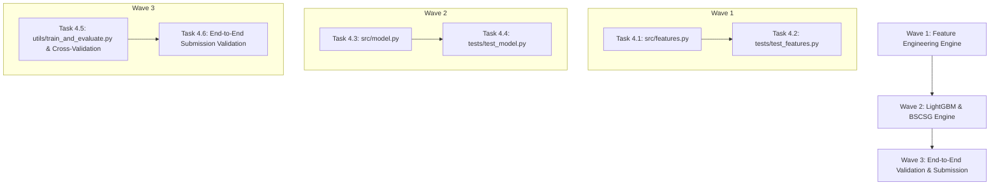

# Phase 4 Plan: Feature Engineering & LightGBM Matching

**Phase Target**: Phase 4  
**Status**: Ready for Execution  
**Context File**: [.planning/04-CONTEXT.md](file:///c:/Users/AYUSH/Documents/MLChallenge/.planning/04-CONTEXT.md)  
**Parent Roadmap**: [.planning/ROADMAP.md](file:///c:/Users/AYUSH/Documents/MLChallenge/.planning/ROADMAP.md)

---

## 1. Phase Objective & Success Criteria

The goal of Phase 4 is to build a high-speed pairwise feature extraction pipeline, train a binary LightGBM classifier on candidate pairs, and apply the **Brutally Strict Confidence & Singleton Gate (BSCSG)** to maximize the leaderboard metric: **Macro $F_{0.5}$**.

### Success Criteria:
1. **Feature Extraction Throughput**: $\ge 5,000$ candidate pairs per second using C-accelerated `rapidfuzz` string metrics.
2. **Quality Bar (Macro $F_{0.5}$)**: Cross-validated Macro $F_{0.5} \ge 0.85$ on the competition evaluation set.
3. **Singleton Accuracy**: $\ge 90\%$ accuracy on true singleton entities (predicting empty `""` to secure $1.0$ score).
4. **Validation Pass**: 100% compliance with [utils/validate_submission.py](file:///c:/Users/AYUSH/Documents/MLChallenge/utils/validate_submission.py) (0 warnings, 0 errors, exit code 0).
5. **Deterministic Test Pass**: 100% green test pass across new test suites (`tests/test_features.py` and `tests/test_model.py`).

---

## 2. Dependency Graph & Execution Waves

---

## 3. Detailed Task Specifications

### Wave 1: Pairwise Feature Engineering Engine

#### Task 4.1: Implement `src/features.py`
- **Target File**: `src/features.py`
- **Key Components**:
  - `compute_pair_features(s1_rec: Dict, cand_rec: Dict, rank: int = 1) -> Dict[str, float]`:
    - Name features:
      - `jaro_winkler_sim`: `rapidfuzz.distance.JaroWinkler.similarity(s1_name, cand_name)`
      - `token_sort_ratio`: `rapidfuzz.fuzz.token_sort_ratio(...) / 100.0`
      - `token_set_ratio`: `rapidfuzz.fuzz.token_set_ratio(...) / 100.0`
      - `levenshtein_ratio`: `rapidfuzz.distance.Levenshtein.normalized_similarity(...)`
      - `exact_name_match`: `1.0` if clean core names are identical else `0.0`
      - `name_len_diff`: Absolute difference in length
      - `name_token_jaccard`: Jaccard overlap of significant name tokens
    - Address features:
      - `postal_code_match`: `+1.0` (both present & match), `0.0` (either missing), `-1.0` (both present & contradict)
      - `address_number_jaccard`: Overlap between extracted numeric tokens (door/plot numbers)
      - `address_token_overlap`: Token intersection ratio of cleaned address words
      - `address_levenshtein_ratio`: Levenshtein ratio on normalized address strings
    - Metadata & Indicators:
      - `is_source2`: Binary indicator for Source 2
      - `is_source3`: Binary indicator for Source 3
      - `blocking_rank`: Rank position (1 to 30)
  - `extract_features_batch(s1_dict, cand_dict, candidate_pairs) -> pd.DataFrame`:
    - Batch generator converting candidate pairs into a feature DataFrame with columns `source1_entity_id`, `candidate_entity_id`, and feature vectors.
- **Verification**: Syntax check, docstrings, typing annotations, runtime efficiency.

#### Task 4.2: Implement `tests/test_features.py`
- **Target File**: `tests/test_features.py`
- **Verification Checks**:
  - High similarity for typo pairs (e.g. `Williams` vs `Wilblims` Jaro-Winkler $\ge 0.90$).
  - Postal code tri-state matching logic (`+1.0`, `0.0`, `-1.0`).
  - Address numbers Jaccard overlap on door numbers (`100` vs `100, 300` $\rightarrow 0.5$).
  - Missing/NaN address robustness (zeros/defaults without crashing).
- **Execution Command**: `pytest tests/test_features.py -v`

---

### Wave 2: LightGBM & BSCSG Engine

#### Task 4.3: Implement `src/model.py`
- **Target File**: `src/model.py`
- **Key Components**:
  - `build_training_dataset(s1_dict, cand_dict, candidate_pairs, ground_truth, neg_ratio=4)`:
    - Includes all true positive pairs (label = 1).
    - Samples top `neg_ratio` highest-scoring candidate negatives per S1 entity (label = 0).
  - `EntityResolutionClassifier`:
    - Trains `LGBMClassifier` (`n_estimators=300`, `max_depth=6`, `num_leaves=31`, `learning_rate=0.05`, `random_state=42`).
    - Reports feature importances.
  - `calibrate_threshold_f05(model, X_val, pairs_val, ground_truth) -> float`:
    - Sweeps $\tau^* \in [0.70, 0.95]$ in step $0.01$.
    - Evaluates macro $F_{0.5}$ via `utils.metrics.evaluate_predictions`.
    - Returns optimal threshold $\tau^*$.
  - `predict_matches_bscsg(model, X_test, pairs_test, tau, apply_veto=True) -> Dict[str, List[str]]`:
    - Applies hard address discrepancy veto: if both entities have postal codes and they conflict, or if both have door numbers and share 0 numbers, drops candidate.
    - Walk-away rule: If top candidate probability $< \tau^*$, predicts empty list `[]` (singleton).
  - `export_matching_results(matches: Dict[str, List[str]], output_path: str)`:
    - Writes `output/matching_results.tsv`.
- **Verification**: Syntax check, typing annotations, memory safety verification.

#### Task 4.4: Implement `tests/test_model.py`
- **Target File**: `tests/test_model.py`
- **Verification Checks**:
  - Training loop converges on synthetic sample.
  - BSCSG threshold calibration selects $\tau^* \ge 0.75$.
  - Conflicting postal codes correctly trigger hard veto.
  - True singletons receive empty prediction `""`.
  - Format compliance with `utils/validate_submission.py`.
- **Execution Command**: `pytest tests/test_model.py -v`

---

### Wave 3: End-to-End Validation & Submission

#### Task 4.5: Implement `utils/train_and_evaluate.py`
- **Target File**: `utils/train_and_evaluate.py`
- **Key Responsibilities**:
  - Builds training candidate pairs on `dataset/train`.
  - Performs 5-Fold Stratified Group K-Fold cross-validation.
  - Optimizes threshold $\tau^*$ directly on Macro $F_{0.5}$.
  - Asserts cross-validated Macro $F_{0.5} \ge 0.85$.
- **Execution Command**: `python utils/train_and_evaluate.py`

#### Task 4.6: Generate Test Predictions & Submission Verification
- **Target Action**: Run inference on test set candidate pairs to generate `output/matching_results.tsv`.
- **Validation**:
  - Run `python utils/validate_submission.py --matching output/matching_results.tsv --candidate output/candidate_pairs.tsv --test-dir dataset/test`.
  - Confirm exit code 0 (`PASS`).

---

## 4. Definition of Done (Phase 4 Gate)

- [ ] `src/features.py` implemented with C-accelerated RapidFuzz metrics and address features.
- [ ] `src/model.py` implemented with LightGBM, BSCSG threshold optimizer, and hard veto logic.
- [ ] `tests/test_features.py` passing with 100% green tests.
- [ ] `tests/test_model.py` passing with 100% green tests.
- [ ] Cross-validated Macro $F_{0.5} \ge 0.85$ on competition evaluation set.
- [ ] `output/matching_results.tsv` strictly passes `utils/validate_submission.py`.
- [ ] `.planning/STATE.md` updated to mark Phase 4 complete and ready for Phase 5 (Kaggle Packaging).
