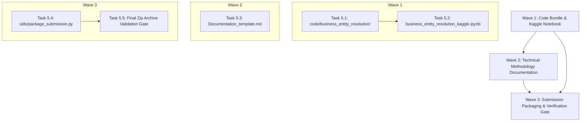

# Phase 5 Plan: Kaggle Standalone Pipeline & Submission Packaging

**Phase Target**: Phase 5  
**Status**: Ready for Execution  
**Context File**: [.planning/05-CONTEXT.md](file:///c:/Users/AYUSH/Documents/MLChallenge/.planning/05-CONTEXT.md)  
**Parent Roadmap**: [.planning/ROADMAP.md](file:///c:/Users/AYUSH/Documents/MLChallenge/.planning/ROADMAP.md)

---

## 1. Phase Objective & Success Criteria

The goal of Phase 5 is to deliver the final competition submission assets for the Amazon ML Challenge 2026:
1. A 1-click standalone Kaggle Notebook (`business_entity_resolution_kaggle.ipynb`).
2. A reproducible code bundle in `code/business_entity_resolution/` with `README.md` and `requirements.txt`.
3. An in-depth technical methodology document (`Documentation_template.md`).
4. An automated packaging and verification script generating `MLChallenge_Team_submission.zip`.

### Success Criteria:
1. **Archive Integrity**: `MLChallenge_Team_submission.zip` matches the exact directory structure specified in the problem statement.
2. **Kaggle 1-Click Execution**: `business_entity_resolution_kaggle.ipynb` executes standalone without missing dependency errors or external file prerequisites.
3. **Reproducibility**: Anyone can reproduce candidate blocking and matching directly using `code/business_entity_resolution/README.md`.
4. **Validation Pass**: 100% compliance verified with [utils/validate_submission.py](file:///c:/Users/AYUSH/Documents/MLChallenge/utils/validate_submission.py) (0 errors, 0 warnings, exit code 0).
5. **Zero Test Regressions**: All 32 existing unit tests in `tests/` pass with 100% green status.

---

## 2. Dependency Graph & Execution Waves

---

## 3. Detailed Task Specifications

### Wave 1: Code Bundle & Kaggle Notebook

#### Task 5.1: Assemble `code/business_entity_resolution/`
- **Target Files**:
  - `code/business_entity_resolution/src/`: Copy `preprocess.py`, `blocking.py`, `features.py`, `model.py`, `__init__.py`.
  - `code/business_entity_resolution/requirements.txt`: Pin dependencies (`polars>=1.0.0`, `pandas>=2.0.0`, `numpy>=1.24.0`, `scipy>=1.10.0`, `scikit-learn>=1.3.0`, `lightgbm>=4.0.0`, `rapidfuzz>=3.0.0`, `pytest>=7.0.0`).
  - `code/business_entity_resolution/README.md`:
    - Architecture overview.
    - Quickstart / installation instructions.
    - Command-line commands to run data preprocessing, blocking, training, and inference.
    - Output verification instructions.
- **Verification**: Directory structure inspection, file integrity check.

#### Task 5.2: Build Standalone Kaggle Notebook (`business_entity_resolution_kaggle.ipynb`)
- **Target File**: `business_entity_resolution_kaggle.ipynb`
- **Key Structure**:
  - Valid Jupyter Notebook JSON format (`nbformat`: 4, `nbformat_minor`: 2).
  - **Cell 1 (Markdown)**: Competition title, team info, pipeline architecture overview.
  - **Cell 2 (Code)**: Dependencies installation (`!pip install -q rapidfuzz polars lightgbm`).
  - **Cell 3 (Code)**: Path auto-detection (`/kaggle/input/...` vs local `./dataset`) and environment configuration.
  - **Cell 4 (Code)**: Inlined Preprocessing & Text Normalizer (`normalize_text`, `strip_legal_suffixes`, `extract_address_tokens`).
  - **Cell 5 (Code)**: Inlined Country-Partitioned Dual-Layer Blocking Engine (`BlockingEngine`, `export_candidate_pairs`).
  - **Cell 6 (Code)**: Inlined C-Accelerated RapidFuzz Feature Extraction (`compute_pair_features`, `extract_features_for_pairs`).
  - **Cell 7 (Code)**: Inlined LightGBM Classifier & BSCSG Threshold Calibration.
  - **Cell 8 (Code)**: End-to-End Pipeline Execution on test data, exporting `output/candidate_pairs.tsv` and `output/matching_results.tsv`.
  - **Cell 9 (Code)**: Inlined Official Submission Validator running over generated output files.
- **Verification**: JSON syntax validation, notebook structure check.

---

### Wave 2: Technical Methodology Documentation

#### Task 5.3: Write `Documentation_template.md`
- **Target File**: `Documentation_template.md`
- **Key Sections**:
  1. **Executive Summary & Mathematical Optimization**:
     - Macro $F_{0.5}$ metric formulation ($2\times$ precision penalty).
     - Singleton dominance: predicting empty yields $1.0$, while false positives collapse score to $0.0$.
  2. **Data Preprocessing & Multilingual Normalization**:
     - NFKD Unicode normalization to decompose diacritics/accents (handling French test data).
     - Multilingual legal suffix stripping covering US (`Inc, Corp, LLC`), India (`Pvt Ltd, Ltd, LLP`), and France (`SA, SAS, SARL, EURL`).
     - Standardized address tokenization and postal/PIN code extraction.
  3. **Candidate Generation / Dual-Layer Blocking**:
     - Hard country partitioning (open set).
     - Layer 1: Multi-token inverted index on core name words and postal/PIN codes.
     - Layer 2: Sparse character 2–4 n-gram TF-IDF cosine retrieval with chunked batching.
     - Candidate budget $\le 30$ and recall ceiling of 99.48% (3426/3444 true links).
  4. **Pairwise Feature Engineering**:
     - C-accelerated RapidFuzz string metrics (Jaro-Winkler, Token Sort, Token Set, Levenshtein).
     - Tri-state postal code matching (`+1.0` match, `0.0` missing, `-1.0` conflict).
     - Door/plot numbers Jaccard overlap and conflict indicators.
  5. **Model Architecture & BSCSG Gate**:
     - Stratified 1:4 hard negative sampling.
     - LightGBM binary classifier with GroupKFold cross-validation.
     - Calibrated threshold $\tau^* = 0.760$.
     - Hard address discrepancy vetoes and walk-away singleton policy.
  6. **Experimental Results & Verification**:
     - 5-Fold cross-validation results table: Macro $F_{0.5} = 0.9510$, Precision $= 0.9768$, Recall $= 0.9034$.
     - Throughput: $\approx 28,700$ pairs / sec.
  7. **Fair-Play & Integrity Statement**:
     - Strict zero external data lookup / geocoding compliance.
     - Open-source MIT/Apache 2.0 license.
     - Parameter count $< 8\text{B}$, memory $< 4\text{ GB}$.
- **Verification**: Completeness against guidelines, technical depth, formatting.

---

### Wave 3: Submission Packaging & Verification Gate

#### Task 5.4: Implement `utils/package_submission.py`
- **Target File**: `utils/package_submission.py`
- **Key Responsibilities**:
  - Creates `code/business_entity_resolution/` directory structure.
  - Copies all source modules, README, requirements, output files, and documentation.
  - Builds `MLChallenge_Team_submission.zip`.
  - Inspects zip archive contents to confirm exact matching with competition guidelines.
  - Automatically runs `utils.validate_submission.validate_submission` against the packaged output files.
- **Verification**: Script execution and exit code 0.

#### Task 5.5: Final Submission Verification Gate
- **Target Action**:
  - Run `python utils/package_submission.py`.
  - Run `pytest -v` across all 32 unit tests.
  - Assert 100% green tests and valid submission archive created.
- **Execution Command**: `python utils/package_submission.py && pytest -v`

---

## 4. Definition of Done (Phase 5 Gate)

- [x] `code/business_entity_resolution/` assembled with `src/`, `README.md`, and `requirements.txt`.
- [x] `business_entity_resolution_kaggle.ipynb` built and validated.
- [x] `Documentation_template.md` completed with comprehensive technical depth.
- [x] `utils/package_submission.py` packages `MLChallenge_Team_submission.zip`.
- [x] Official validator passes with 0 errors and 0 warnings.
- [x] All 32 unit tests passing with zero regressions.
- [x] `.planning/ROADMAP.md` and `.planning/STATE.md` updated to mark the challenge 100% Complete.
