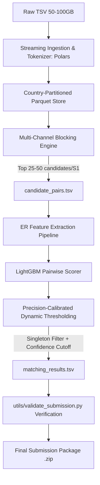

# Project Specification: Business Entity Resolution at Scale

**Project Name**: Business Entity Resolution Challenge  
**Time Horizon**: 72 Hours  
**Scale Target**: 50–100 GB Tab-Separated Data  
**Primary Metric**: Macro $F_{0.5}$ Score (Precision-Weighted)  
**Execution Target**: Kaggle Environment (30 GB RAM, CPU/GPU, 12h session limit, 20 GB `/kaggle/working`) + Local Development  

---

## 1. Executive Summary & Objective

In commercial platforms, business identity data arrives from multiple independent sources with high noise, missing components, transliterations, and differing address conventions. 
- **Source 1**: Deduplicated reference source ($S1$).
- **Source 2 & Source 3**: Noisy data sources ($S2, S3$).
- **Goal**: For every entity in $S1$, determine all corresponding matching entity IDs in $S2$ and $S3$. Each $S1$ entity can match zero (singleton), one, or multiple records.
- **Constraints**: 
  - Strictly **NO external data lookup / geocoding / commercial ER APIs**.
  - Final model: Open-source (MIT/Apache 2.0), $\le 8\text{B}$ parameters.
  - Test set contains unseen country (France) alongside train countries (US, India).
  - Must produce two tab-separated files: `matching_results.tsv` and `candidate_pairs.tsv`.
  - All predictions in `matching_results.tsv` must be a subset of `candidate_pairs.tsv`.

---

## 2. Mathematical Optimization: Macro $F_{0.5}$

Evaluation uses per-entity $F_{\beta}$ with $\beta = 0.5$ (macro-averaged over all Source 1 entities):

$$F_{0.5} = \frac{1.25 \times \text{Precision} \times \text{Recall}}{0.25 \times \text{Precision} + \text{Recall}}$$

### Critical Operational Implications:
1. **Precision Bias ($2\times$)**: False merges penalize the score twice as heavily as missed matches. A conservative, high-confidence matching threshold is mathematically optimal.
2. **Singleton Dominance**: An entity with no true matches receives an $F_{0.5}$ of **1.0** if and only if predicted empty, and **0.0** if any match is falsely predicted. Aggressive singleton pruning is mandatory.

---

## 3. System Architecture & Component Design

### Component 1: Out-of-Core Data Engine
- **Engine**: Polars Streaming (`pl.scan_csv`) with out-of-core chunking.
- **Memory Footprint**: Peak RAM $< 4\text{ GB}$ (well within Kaggle's 30 GB RAM).
- **Disk Footprint**: Ingests directly into partitioned Snappy-compressed Parquet by `country`. 100 GB TSV compresses to $\approx 20\text{ GB}$ on disk.

### Component 2: Multi-Stage Blocking (Candidate Generation)
- **Hard Partition**: Group by `country` (open set, handles US, India, France dynamically).
- **Blocking Keys**:
  - Exact normalized name tokens (removing legal suffixes like Corp, Pvt Ltd, Inc).
  - Address tokens (postal/PIN codes, municipal numbers, street tokens).
  - Character n-gram MinHash / Sparse TF-IDF Top-$K$ similarity.
- **Candidate Pool**: Limits each $S1$ entity to top $\le 30\text{--}50$ candidates.
- **Audit Output**: Writes directly to `output/candidate_pairs.tsv`.

### Component 3: Feature Engineering & Pairwise Classifier
- **Features Extracted per Candidate Pair**:
  1. String Distance: Jaro-Winkler, Levenshtein ratio, Token Sort ratio, Token Set ratio.
  2. Substring & Token Overlap: Exact token intersection / union, name length difference.
  3. Address Specifics: Digit/PIN code match ratio, common address word overlap.
  4. Source Agreement: Source indicator features ($S2$ vs $S3$).
- **Classifier**: LightGBM Binary Classifier (trained on ground-truth matches + hard negative sampled candidates).
- **Brutally Strict Confidence & Singleton Gate (BSCSG)**:
  - **Philosophy**: Default state is Singleton ($\emptyset$). The model must prove high certainty before declaring a match.
  - **Threshold Calibration**: Because singletons score $1.0$ when empty and $0.0$ on any false positive, the probability threshold $\tau^*$ is calibrated directly against Macro $F_{0.5}$ on the validation split (typically in the high range $\tau \approx 0.80\text{--}0.90$).
  - **Hard Numeric/Address Veto**: Even with high name similarity, conflicting street/door numbers or contradictory postal codes trigger an immediate veto to empty.
  - **Walk-Away Rule**: If the top candidate probability $< \tau^*$, leave the match completely blank.
- **Output**: Writes directly to `output/matching_results.tsv`.

---

## 4. Verification, Validation & CI/CD Strategy

1. **Synthetic / Mini-Benchmark (Phase 3.1)**:
   - Generate a representative synthetic sample (1,000 S1 records, 3,000 S2/S3 records, noise patterns: abbreviations, typos, landmark addresses, singletons, multi-matches).
   - Test the entire pipeline locally from end to end in $< 30$ seconds.
2. **Submission Verifier Hook**:
   - Integrate `utils/validate_submission.py` checking:
     - All test $S1$ entities present (exactly 1 row each).
     - Matched IDs $\subseteq$ Candidate IDs.
     - Valid source prefixes ($S2-, S3-$ only).
     - No duplicates in ID lists.
3. **Kaggle Deployment Package**:
   - Single standalone, high-performance notebook `business_entity_resolution_kaggle.ipynb` with self-contained dependencies and progress bars.
   - Pinned `requirements.txt` and clean `README.md`.
   - Complete `Documentation_template.md` covering methodology, blocking strategy, and feature engineering.

---

## 5. Execution Roadmap

- **Phase 1: Planning & Discovery** (Current - Spec agreed upon)
- **Phase 2: Local Foundation & Synthetic Benchmark Harness**
  - Implement exact Macro $F_{0.5}$ scorer and validator.
  - Implement synthetic data generator mimicking real noise patterns.
- **Phase 3: Out-of-Core Blocking & Feature Engineering Pipeline**
  - Implement streaming normalizer and country-aware inverted index blocking.
  - Implement fast pairwise feature extractor (Jaro-Winkler, Levenshtein, address tokens).
- **Phase 4: LightGBM Model & F0.5 Threshold Calibration**
  - Train model, run threshold optimizer against Macro $F_{0.5}$ validation set.
- **Phase 5: Kaggle Standalone Notebook & Submission Builder**
  - Package end-to-end pipeline into one-click Kaggle notebook.
  - Package final submission zip generator and methodology documentation.
